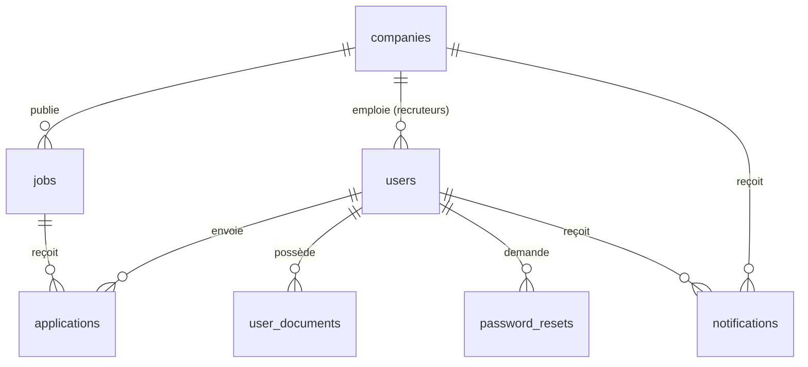

# Epitech Job Board

Un site d'offres d'emploi réalisé dans le cadre du projet **Job Board** d'Epitech.

Les candidats consultent les offres, lisent le détail sans quitter la page et postulent avec leur CV. Les entreprises s'inscrivent avec leur numéro SIRET, publient leurs offres une fois validées par l'équipe, puis suivent les candidatures reçues. Un administrateur gère l'ensemble des données depuis une page dédiée.

Le projet repose sur trois briques :

- une base **MySQL** (offres, entreprises, personnes, candidatures…) ;
- une **API REST en PHP**, sans framework, qui est le seul point d'accès aux données ;
- un **front en HTML, CSS et JavaScript**, servi par Vite, qui récupère tout ce qu'il affiche avec `fetch()`.

## Accès rapide

Une fois le projet installé et lancé (voir plus bas) :

| | Adresse | Identifiants |
| --- | --- | --- |
| Le site | <http://127.0.0.1:5173> | `candidat@jobboard.local` / `Candidat123!` ou `entreprise@jobboard.local` / `Entreprise123!` |
| **L'administration** | <http://127.0.0.1:5173/admin.html> | **`admin@jobboard.local` / `Admin123!`** |

Les autres comptes de test sont détaillés dans [Comptes de démonstration](#comptes-de-démonstration).

---

## Sommaire

1. [Prérequis](#prérequis)
2. [Installation](#installation)
3. [Configuration](#configuration)
4. [Lancer le projet](#lancer-le-projet)
5. [Comptes de démonstration](#comptes-de-démonstration)
6. [Les pages](#les-pages)
7. [La base de données](#la-base-de-données)
8. [L'API](#lapi)
9. [Organisation du code](#organisation-du-code)
10. [Bon à savoir](#bon-à-savoir)

---

## Prérequis

- **Node.js** et **npm** (pour Vite) ;
- **PHP 8.1 ou plus**, avec les extensions `pdo_mysql`, `fileinfo` et `mbstring` ;
- **MySQL 8** ou MariaDB.

Sous Windows, le plus simple est d'installer [WampServer](https://www.wampserver.com/), qui fournit PHP, MySQL et phpMyAdmin. Le script `npm run api` sait retrouver le PHP de WAMP tout seul.

## Installation

### 1. Récupérer le projet

```bash
git clone https://github.com/Sabina-Kari-ai/Epitech-Job-Board.git
cd Epitech-Job-Board
npm install
```

### 2. Créer la base de données

Crée une base vide nommée `job_board` (encodage `utf8mb4_unicode_ci`), puis importe **dans cet ordre** les deux fichiers du dossier `database/` :

| Fichier | Contenu |
| --- | --- |
| `database/schema.sql` | La structure : toutes les tables, clés étrangères et index |
| `database/seed.sql` | Des données de démonstration : entreprises, offres, candidatures et comptes de test |

Avec phpMyAdmin : sélectionne la base `job_board`, onglet **Importer**, puis un fichier après l'autre.

En ligne de commande :

```bash
mysql -u root -e "CREATE DATABASE job_board CHARACTER SET utf8mb4 COLLATE utf8mb4_unicode_ci"
mysql -u root job_board < database/schema.sql
mysql -u root job_board < database/seed.sql
```

> ⚠️ `schema.sql` supprime puis recrée les tables. Ne l'importe pas sur une base dont tu veux garder les données.

`seed.sql` n'est là que pour démarrer avec quelque chose à regarder : en dehors de ça, la base se remplit normalement par le site (inscriptions, publications, candidatures) et par la page d'administration.

## Configuration

Par défaut, l'API se connecte à `localhost:3306`, base `job_board`, utilisateur `root` sans mot de passe : c'est la configuration de WAMP. Si la tienne est différente, tu peux soit modifier [`api/config/database.php`](api/config/database.php), soit définir ces variables d'environnement avant de lancer l'API :

| Variable | Valeur par défaut |
| --- | --- |
| `DB_HOST` | `localhost` |
| `DB_PORT` | `3306` |
| `DB_NAME` | `job_board` |
| `DB_USER` | `root` |
| `DB_PASSWORD` | *(vide)* |

Pour la fonction « mot de passe oublié », deux variables supplémentaires :

- `FRONTEND_URL` : adresse du front utilisée dans le lien envoyé par e-mail (par défaut `http://127.0.0.1:5173`) ;
- `MAIL_FROM` : adresse d'expédition des e-mails.

PHP doit aussi être configuré pour envoyer des e-mails (fonction `mail()`). En local, sans serveur SMTP, la demande renvoie une erreur 503 explicite : c'est normal.

## Lancer le projet

Il faut deux terminaux, ouverts à la racine du projet.

### L'API (PHP, port 8001)

```bash
npm run api
```

Si le script ne trouve pas PHP, lance directement : `php -S 127.0.0.1:8001 -t .`

### Le front (Vite, port 5173)

```bash
npm run dev
```

Ensuite :

- le site : <http://127.0.0.1:5173>
- l'administration : <http://127.0.0.1:5173/admin.html>

Utilise bien `127.0.0.1` (ou bien `localhost`) partout, sans mélanger les deux : le cookie de session est lié au nom d'hôte.

Pour générer une version de production du front : `npm run build` (fichiers dans `dist/`).

## Comptes de démonstration

Créés par `database/seed.sql` :

| Rôle | E-mail | Mot de passe | Ce qu'on peut tester |
| --- | --- | --- | --- |
| Administrateur | `admin@jobboard.local` | `Admin123!` | Toute la page d'administration |
| Candidat | `candidat@jobboard.local` | `Candidat123!` | Postuler, suivre ses candidatures, recevoir les réponses |
| Entreprise validée | `entreprise@jobboard.local` | `Entreprise123!` | Publier des offres et traiter les candidatures (Epitech) |
| Entreprise en attente | `nova@jobboard.local` | `Entreprise123!` | Voir le blocage avant validation, puis la valider côté admin |

Après la connexion, chacun arrive sur sa page : l'admin sur `admin.html`, l'entreprise sur son tableau de bord, le candidat sur la liste des offres.

L'administration a **sa propre session**, séparée de celle du site : on peut être connecté en entreprise (ou en candidat) dans un onglet et en administrateur dans un autre, dans le même navigateur, sans que l'un déconnecte l'autre. C'est pratique pour tester la validation d'une entreprise en direct. Côté API, la page admin le signale avec l'en-tête `X-Session-Scope: admin` ; un compte administrateur qui se connecte depuis `login.html` est lui aussi envoyé dans cette session.

> Ces mots de passe sont publics : change-les si le projet est un jour mis en ligne.

## Les pages

Toutes les pages sont dans `public/`.

| Page | Pour qui | Rôle |
| --- | --- | --- |
| `index.html` | Tout le monde | Liste des offres avec recherche et filtres. Chaque offre affiche son titre, une description courte, un bouton **En savoir plus** (le détail complet est chargé depuis l'API et s'ouvre dans la carte, sans recharger la page ni ouvrir de popup) et un bouton **Postuler** |
| `job.html?id=…` | Tout le monde | Détail d'une offre sur une page à part (utilisé par les alertes) |
| `companies.html` | Tout le monde | Les entreprises validées et leur nombre d'offres |
| `login.html` | Tout le monde | Connexion |
| `register.html` | Tout le monde | Création d'un compte candidat ou entreprise (avec SIRET pour une entreprise) |
| `forgot-password.html`, `reset-password.html` | Tout le monde | Réinitialisation du mot de passe par e-mail |
| `apply.html?id=…` | Candidat | Formulaire de candidature : nom, e-mail et téléphone pré-remplis, CV du profil chargé automatiquement, message au recruteur |
| `app.html` | Candidat | Mes candidatures, avec leur statut et les réponses des recruteurs |
| `profile.html` | Candidat | Modifier son profil, ses documents (CV, lettre), son e-mail, son mot de passe ; supprimer son compte |
| `alerts.html` | Candidat | Alertes emploi et offres correspondantes |
| `company-dashboard.html` | Entreprise | Tableau de bord, publication et gestion des offres, candidatures reçues, notifications, paramètres du compte |
| `admin.html` | Admin | Statistiques et gestion complète des offres, entreprises, utilisateurs et candidatures |

### Le parcours d'une entreprise

1. Elle s'inscrit sur `register.html` en donnant son numéro **SIRET**. Le serveur vérifie qu'il fait 14 chiffres, que sa clé de contrôle (Luhn) est correcte et qu'il n'est pas déjà utilisé.
2. Elle arrive sur son tableau de bord, avec un bandeau « inscription en cours de validation ». La publication d'offres est bloquée, dans l'interface comme dans l'API.
3. Un administrateur la valide (ou la refuse) depuis `admin.html`. L'entreprise reçoit une notification et peut publier.
4. À chaque candidature reçue, une notification apparaît sous la cloche de son tableau de bord. Quand elle change le statut d'une candidature (en cours d'étude, entretien, acceptée, refusée), le candidat est prévenu à son tour sur sa page « Mes candidatures ».

### La page d'administration

- **Tableau de bord** : chiffres clés, inscriptions d'entreprises à valider, dernières candidatures.
- **Offres**, **Entreprises**, **Utilisateurs**, **Candidatures** : pour chaque table, liste paginée (10 lignes par page), recherche, filtres, création, modification et suppression.
- Les suppressions qui casseraient les données sont refusées avec un message clair : une offre qui a déjà reçu des candidatures, une entreprise qui a encore des offres, ou son propre compte admin.

## La base de données

Le schéma complet et commenté est dans [`database/schema.sql`](database/schema.sql).



| Table | Ce qu'elle contient |
| --- | --- |
| `companies` | Les entreprises : nom, ville, description, logo, **SIRET** et **statut** de l'inscription (`pending`, `approved`, `rejected`) |
| `users` | Toutes les personnes : candidats, recruteurs (liés à une entreprise par `company_id`) et administrateurs, distingués par `role`. Le mot de passe est stocké haché |
| `jobs` | Les offres : titre, lieu, type de contrat, salaire, description courte et complète, lettre de motivation obligatoire ou non |
| `applications` | Les candidatures : l'offre concernée, le candidat, ses coordonnées et son message au moment de l'envoi, le CV et la lettre en PDF, le statut et les dates |
| `user_documents` | Le CV et la lettre enregistrés dans le profil d'un candidat, réutilisés pour postuler |
| `password_resets` | Les demandes de réinitialisation du mot de passe (seul le hash du jeton est conservé, valable 30 minutes) |
| `notifications` | Les notifications des entreprises (nouvelle candidature, inscription validée ou refusée) et des candidats (changement de statut d'une candidature) |

Les coordonnées du candidat sont recopiées dans `applications` au moment où il postule : on garde ainsi une trace de chaque candidature, même si le compte est supprimé ensuite (son `user_id` passe alors à `NULL`).

## L'API

Elle est servie sur `http://127.0.0.1:8001`. Les routes nomment des ressources, et c'est le verbe HTTP qui dit ce qu'on en fait. Les corps de requête sont en JSON, sauf l'envoi de fichiers (candidature, documents du profil, logo) qui passe en `multipart/form-data`.

L'authentification se fait par **session PHP** : le front envoie le cookie avec `credentials: "include"`. Il y a deux cookies distincts : `PHPSESSID` pour le site (candidats, entreprises) et `JOBBOARD_ADMIN` pour l'administration, utilisé quand la requête porte l'en-tête `X-Session-Scope: admin` (ou `?scope=admin` pour un lien de téléchargement).

Les codes de retour suivent ce que la requête a produit :

| Code | Signification |
| --- | --- |
| `200` | Tout s'est bien passé |
| `201` | Un élément a été créé |
| `400` | Un champ obligatoire manque ou est invalide |
| `401` | Il faut être connecté |
| `403` | Le compte connecté n'a pas le droit de faire ça |
| `404` | L'identifiant demandé n'existe pas |
| `409` | Conflit : e-mail ou SIRET déjà utilisé, suppression impossible… |

Les listes acceptent une pagination facultative : `?page=2&limit=10`. Avec `page`, la réponse devient `{ data, page, limit, total, pages }` ; sans, c'est un simple tableau.

### Offres — `/api/jobs/`

| Méthode | Route | Description | Accès |
| --- | --- | --- | --- |
| `GET` | `/api/jobs/` | Liste des offres. Filtres : `q`, `location`, `contract_type`, `company` | Public (offres des entreprises validées) |
| `GET` | `/api/jobs/?mine=1` | Offres de l'entreprise connectée | Entreprise |
| `GET` | `/api/jobs/?id=1` | Détail complet d'une offre | Public |
| `POST` | `/api/jobs/` | Publier une offre | Admin, entreprise validée |
| `PUT` | `/api/jobs/` | Modifier une offre (`id` dans le JSON) | Admin, entreprise propriétaire |
| `DELETE` | `/api/jobs/?id=1` | Supprimer une offre sans candidature | Admin, entreprise propriétaire |

### Entreprises — `/api/companies/`

| Méthode | Route | Description | Accès |
| --- | --- | --- | --- |
| `GET` | `/api/companies/` | Liste avec le nombre d'offres. L'admin voit aussi le SIRET, le statut et le contact, et peut filtrer par `status` et `q` | Public / Admin |
| `GET` | `/api/companies/?id=1` | Détail d'une entreprise | Public |
| `POST` | `/api/companies/` | Créer une entreprise | Admin |
| `PUT` | `/api/companies/` | Modifier une entreprise (`id` dans le JSON) | Admin |
| `PATCH` | `/api/companies/?id=1` | Valider ou refuser une inscription : `{ "status": "approved" }` | Admin |
| `DELETE` | `/api/companies/?id=1` | Supprimer une entreprise sans offre | Admin |
| `POST` | `/api/companies/logo.php` | Envoyer le logo de son entreprise (PNG, JPG ou WebP, 2 Mo max) | Entreprise |

### Candidatures — `/api/app/`

| Méthode | Route | Description | Accès |
| --- | --- | --- | --- |
| `GET` | `/api/app/` | Candidatures visibles par le compte connecté. Filtres : `status`, `job_id`, `q` | Candidat (les siennes), entreprise (celles de ses offres), admin (toutes) |
| `GET` | `/api/app/?id=1` | Détail d'une candidature | Idem |
| `GET` | `/api/app/?id=1&attachment=cv` | Télécharger le CV (`attachment=cover-letter` pour la lettre) | Idem |
| `POST` | `/api/app/` | Postuler : `job_id`, coordonnées, `message`, `cv` (PDF obligatoire) et lettre si l'offre l'exige | Candidat |
| `PUT` | `/api/app/` | Changer le statut (`id`, `status`) : le candidat est notifié | Admin, entreprise propriétaire de l'offre |
| `DELETE` | `/api/app/?id=1` | Supprimer une candidature | Admin |

### Utilisateurs — `/api/users/`

| Méthode | Route | Description | Accès |
| --- | --- | --- | --- |
| `GET` | `/api/users/` | Liste des utilisateurs. Filtres : `role`, `q` | Admin |
| `GET` | `/api/users/?id=1` | Détail d'un utilisateur | Admin |
| `POST` | `/api/users/` | Créer un compte (candidat, recruteur ou admin) | Admin |
| `PUT` | `/api/users/` | Modifier un compte ; le mot de passe n'est changé que s'il est fourni | Admin |
| `DELETE` | `/api/users/?id=1` | Supprimer un compte (ses candidatures sont conservées) | Admin |

### Compte et session — `/api/auth/`

| Méthode | Route | Description |
| --- | --- | --- |
| `GET` | `/api/auth/` | Utilisateur connecté (401 si personne) |
| `POST` | `/api/auth/` | Une action, précisée par le champ `action` : `register`, `login`, `logout`, `profile` (candidat), `company_profile` (entreprise), `change_email`, `change_password`, `delete_account` (candidat) |
| `POST` | `/api/auth/forgot-password.php` | Envoyer un lien de réinitialisation par e-mail |
| `POST` | `/api/auth/reset-password.php` | Choisir un nouveau mot de passe à partir du lien |

### Autres routes

| Méthode | Route | Description | Accès |
| --- | --- | --- | --- |
| `GET`, `PUT` | `/api/notifications/` | Notifications du compte connecté ; `PUT` avec `{ "id": 3 }` ou `{ "all": true }` les marque comme lues | Entreprise, candidat |
| `GET`, `POST`, `DELETE` | `/api/profile-documents/` | CV et lettre du profil (`?type=cv` pour télécharger) | Candidat |
| `GET` | `/api/stats/` | Chiffres du tableau de bord d'administration | Admin |

## Organisation du code

```text
api/
  config/        connexion à la base, session et CORS, fonctions partagées
  jobs/          offres
  companies/     entreprises et logo
  app/           candidatures
  users/         utilisateurs (admin)
  auth/          inscription, connexion, compte, mot de passe oublié
  notifications/ notifications
  profile-documents/  documents du profil candidat
  stats/         statistiques admin
database/
  schema.sql     structure de la base
  seed.sql       données de démonstration
public/
  *.html         les pages
  css/style.css  la feuille de style unique
  js/            un script par page, plus quelques scripts communs
                 (auth-client.js, nav-auth.js, language.js)
uploads/         logos envoyés par les entreprises
scripts/         démarrage de l'API sous Windows
```

## Bon à savoir

- Le site est bilingue français / anglais : la langue suit celle du navigateur et peut être changée dans le profil (`language.js`).
- Les alertes emploi sont enregistrées dans le navigateur (localStorage), pas en base.
- Les CV et lettres sont stockés directement en base (colonnes BLOB), 5 Mo maximum par fichier ; les logos sont enregistrés dans `uploads/company-logos/`.
- Le CORS de l'API n'autorise que le front local (ports 5173 et 4173). Pour un autre domaine, ajoute-le avec la variable `FRONTEND_ORIGIN`.
